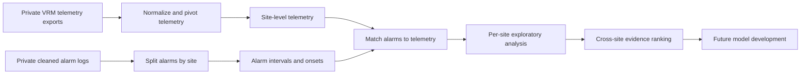

# Solar Site Predictive Maintenance

Work-in-progress data pipeline for turning multi-site solar telemetry and alarm logs into maintenance-relevant event datasets and exploratory early-warning evidence.

> **Project status:** Data preparation, master-table construction, data-quality auditing, conservative short-gap interpolation, and exploratory alarm/telemetry analysis are documented as completed. Predictive model training, out-of-sample validation, and deployment are not yet complete.

This project is part of my DENSYS master's programme Challenge-Based Module, undertaken across semesters 2 and 3 in collaboration with the UNDP Information and Technology Management Green Energy Team.

## Why this project exists

Decentralized solar photovoltaic, battery-storage, and hybrid systems can serve remote and operationally constrained locations. Their long-term value depends on reliable operation and maintenance. The project investigates how routinely collected Victron Remote Management (VRM) telemetry and alarm logs can support a shift from reactive maintenance toward earlier, evidence-based intervention.

The current work deliberately follows a data-first approach. It does not assume that a complex AI model is automatically appropriate. The available labels, telemetry coverage, sampling interval, missing values, and differences between sites are assessed before model selection.

## Latest documented progress

The latest project presentation is dated 9 October 2026 and covers data through 5 October 2026. It reports that a master table was built and six data-quality problems were addressed, including lost true-zero measurements, ambiguous blank alarm fields, heterogeneous site channels, and malformed or short alarm intervals.

The current gap-filling policy fills a missing interval only when all five checks pass:

1. the gap is no more than 30 minutes and has measurements on both sides;
2. no alarm is active, starts, or clears within 60 minutes;
3. Total kWh at both edges is not unusually low for that hour;
4. energy flows and battery level remain continuous across the gap; and
5. no rejected gap occurs within two hours.

When eligible, the missing values are linearly interpolated, `Total kWh` is rebuilt from directional flows, and alarm fields are left unchanged. Otherwise, the gap remains missing and the rejection reason is recorded.

The presentation reports 963 filled gaps out of 1,048 short gaps. It also reports that 97.4% of missing 15-minute slots belong to gaps longer than one day, so those gaps remain empty. These values are progress-report results, not outputs reproduced from the sanitized public notebooks in this repository.

## Current scope

The implemented pipeline currently:

1. reads long-format VRM telemetry exports;
2. normalizes selected parameter codes and pivots records into site-level time series;
3. checks timestamp coverage, missing values, duplicate keys, and sampling gaps;
4. splits cleaned alarm records by site;
5. maps alarm-active intervals to approximately 15-minute telemetry rows;
6. aligns exact alarm starts to the nearest telemetry observation within 20 minutes;
7. compares alarm-active, alarm-onset, and baseline operating periods;
8. ranks exploratory parameter patterns across sites; and
9. exports tables and figures for engineering review.

The project has **not** yet produced a validated predictive-maintenance model or an operational alarm threshold.

## Workflow



## Data and methods

The September 2026 interim report documents the following project dataset at that stage:

- 23 remotely monitored sites in the wider VRM portfolio;
- 16,019 alarm events from June 2021 to May 2026;
- 54 alarm categories;
- 1,276 alarms in the recent high-resolution telemetry window;
- 12 sites with alarms in that window; and
- 160,619 site/timestamp telemetry rows, typically sampled every 15 minutes.

The public repository does **not** include partner telemetry, alarm records, site names, credentials, maintenance tickets, or internal reports. Placeholder site identifiers are used in examples.

The principal mapped telemetry variables are energy-flow measurements:

- solar to load, battery, and grid (`kWh`);
- battery to load and grid (`kWh`);
- grid to load and battery (`kWh`);
- total energy flow (`kWh`); and
- battery state of charge (`%`) where the source attribute is available.

The exploratory analysis uses point-biserial correlation, median shifts, baseline 10th and 90th percentiles, alarm-rate lift by quantile, and an evidence score based on normalized median shift, mapped-event count, and the share of extreme alarm-onset values. These are screening tools, not causal tests or manufacturer alarm limits.

## Findings so far

The interim analysis supports the following limited conclusions:

- alarm logs are a practical proxy-label source when confirmed maintenance-failure labels are sparse;
- battery-to-load flow was the most repeatable exploratory association across several analyzed sites;
- total energy flow and solar-to-load flow showed useful but site-dependent patterns;
- grid-to-load behavior was important for at least one site configuration; and
- site-level aggregation, missing measurements, uneven alarm frequency, and short telemetry retention remain major limitations.

No classification accuracy, failure lead time, avoided downtime, cost saving, or component-life extension has been verified by this repository.

The next modelling decision is still open: either train one model using parameters common to all selected sites or group sites by available telemetry channels and train separate models for compatible groups.

## Repository structure

```text
.
|-- .github/workflows/quality.yml
|-- config/
|   `-- sites.example.csv
|-- data/
|   |-- raw/README.md
|   `-- processed/README.md
|-- docs/
|   |-- DATA_DICTIONARY.md
|   |-- FILE_INVENTORY.md
|   |-- METHODOLOGY.md
|   |-- PORTFOLIO.md
|   |-- PROJECT_STATUS.md
|   `-- VERIFICATION.md
|-- notebooks/
|   |-- 01_prepare_telemetry.ipynb
|   |-- 02_prepare_alarm_logs.ipynb
|   |-- 03_match_alarms_to_telemetry.ipynb
|   |-- 04_site_alarm_parameter_analysis_template.ipynb
|   |-- 05_aggregate_results.ipynb
|   `-- 06_score_alarm_onset_evidence.ipynb
|-- results/README.md
|-- scripts/
|   |-- run_pipeline.py
|   `-- verify_repository.py
|-- tests/test_publication_safety.py
|-- .gitignore
|-- CONTRIBUTING.md
|-- LICENSE
|-- LICENSE_STATUS.md
|-- SECURITY.md
`-- requirements.txt
```

## Installation

Python 3.10 or newer is recommended.

```bash
python -m venv .venv
```

Activate the environment:

```bash
# Windows PowerShell
.venv\Scripts\Activate.ps1

# macOS or Linux
source .venv/bin/activate
```

Install the dependencies:

```bash
python -m pip install --upgrade pip
python -m pip install -r requirements.txt
```

## Configure private inputs

Copy the example site configuration and replace the placeholder identifiers with authorized identifiers in your local copy:

```bash
cp config/sites.example.csv config/sites.csv
```

On Windows PowerShell:

```powershell
Copy-Item config/sites.example.csv config/sites.csv
```

Place authorized inputs in `data/raw/` using these filenames:

```text
data/raw/site_stats_part1.csv
data/raw/site_stats_part2.csv
data/raw/site_stats_part3.csv
data/raw/vrm_alarm_logs_clean.csv
```

Required columns and units are documented in [docs/DATA_DICTIONARY.md](docs/DATA_DICTIONARY.md). The `data/raw/`, `data/processed/`, `results/`, `work/`, and local `config/sites.csv` contents are ignored by Git.

## Run the workflow

The notebook runner executes preparation notebooks, creates one private working copy of the site-analysis template per configured site, then runs aggregation and scoring.

```bash
python scripts/run_pipeline.py
```

To inspect or run the notebooks manually:

```bash
jupyter lab
```

Run notebooks in numeric order. Notebook 04 is a template; the runner injects each configured site identifier and name into a private copy under `work/notebooks/`.

## Outputs

Generated outputs are intentionally untracked:

- `data/processed/`: wide telemetry, alarm-enhanced telemetry, coverage and validation tables;
- `work/notebooks/`: executed site-specific notebook copies;
- `results/site_<id>/`: per-site tables and figures; and
- `results/`: cross-site summaries and evidence-ranking figures.

Candidate thresholds are exploratory and must be checked against device configuration, manufacturer definitions, higher-resolution measurements, and independent data before operational use.

## Reproducibility and verification

The original private workflow was executed on the project data and recorded no prior notebook execution errors, but one isolation check failed because existing project files had changed during the broader working process. The latest presentation documents a stricter five-check interpolation workflow; a standalone source file implementing that exact policy was not located in the supplied folder, so this public copy does not claim to reproduce the 963-gap result. The public repository has been checked separately for notebook structure, Python syntax, hard-coded local paths, site names, data files, and credential-like strings. See [docs/VERIFICATION.md](docs/VERIFICATION.md).

## Limitations and next steps

- Alarm activation is a proxy label, not a confirmed component failure.
- Telemetry is site-level rather than inverter-, string-, or battery-level.
- The high-resolution retention window is short and differs by site.
- Alarm classes and sites are imbalanced.
- Measurements are autocorrelated and often incomplete.
- Some alarms are shorter than the telemetry interval.
- Exploratory associations may reflect protection behavior after an event rather than a precursor.

Planned work includes alarm-group definition, missing-data treatment, time-aware train/test splits, interpretable baseline classifiers, forecasting/anomaly-detection comparisons, and engineering validation of any proposed early-warning signal.

## Academic context and contribution

This is my Challenge-Based Module within the DENSYS master's programme, spanning semesters 2 and 3 and conducted with the UNDP Information and Technology Management Green Energy Team. The project remains in progress. The interim report lists Baleegha Fatima, Evelyn Ogbuka, and Md Atiq Aziz as team members. Individual contribution roles should be confirmed before publication; see [docs/PORTFOLIO.md](docs/PORTFOLIO.md).

## License and citation

This repository is **All Rights Reserved** and is not open-source software.
Public visibility permits viewing and forking through GitHub under GitHub's
Terms of Service, but no broader permission to reuse, modify, distribute, or
create derivative works is granted. Partner telemetry, alarm records, site
identities, credentials, and other operational datasets are not included or
licensed. See [LICENSE](LICENSE) and [LICENSE_STATUS.md](LICENSE_STATUS.md).

A `CITATION.cff` file has intentionally not been added because final authorship, contribution roles, release version, and publication approval are not yet confirmed.

## Contact

- Project contact: **Md Atiq Aziz** — [atiqaziz@iut-dhaka.edu](mailto:atiqaziz@iut-dhaka.edu)
- Portfolio: [GitHub engineering projects](https://github.com/sadat013?tab=repositories)
- Academic affiliation: Erasmus Mundus Joint Master's Programme in Decentralized Smart Energy Systems (DENSYS); KTH Royal Institute of Technology
